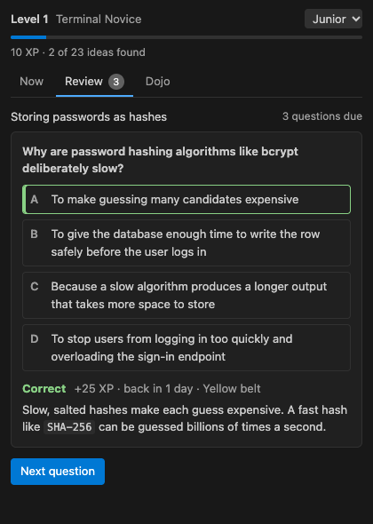

# Miyagi: learn while your AI codes

A side panel that watches what your AI assistant builds and teaches you the few ideas worth owning. It sits beside the assistant, not inside it: the assistant is never told the tutor exists, so it is not slowed down and its answers do not change.

Works in VS Code and its forks (Cursor, Antigravity, Windsurf), with any assistant that edits files in a git repository.

<p>
  
  
</p>

## Setup

There is nothing to configure. On first run Miyagi offers **Set up for me**, and one click:

- starts watching every git repository in the window (this is already on),
- picks the AI that will write explanations from the assistants it finds on your machine,
- turns on command capture for Claude Code and Cursor if they are installed, and
- opens the panel.

Run **Miyagi: Set Up Everything for Me** at any time to do the same. It is safe to repeat. Capture is the only step that edits another tool's settings, which is why it waits for that click.

## What you get

- **A card when it matters.** When new code relies on an idea such as password hashing, a React effect or a hard-coded secret, a card appears: what it is, what to know at your level, and how it goes wrong. At most two ideas per change; the rest are named and left for next time.
- **"Explain in my code".** One button asks an AI to explain the idea using the actual lines in your file, with line numbers.
- **A question that comes back.** Each idea leaves one multiple-choice question. Answer it now, then again after 10 minutes, 1, 3, 7, 16 and 35 days. A belt per idea shows how firmly you hold it.
- **The commands your assistant ran** (optional), with a short lesson for the common ones.
- **Topics.** Pick Security, Backend and APIs, Data, Frontend or Tooling at the top of the panel to see and review only that shelf.
- **A dojo you can browse.** Every idea is listed with its belt. Click one to read its lesson, see where it showed up in your code, and answer its question. Locked ideas can be read; their question unlocks when your assistant writes code that uses them.

## Who pays for the explanations

You do, through an assistant you already use. Miyagi has no account, no API key and no server. "Explain in my code" runs on one of these, on your existing login:

| Provider | How it is called | Tested |
| --- | --- | --- |
| Claude Code | The `claude` binary, headless, with the `haiku` model by default. Found on your PATH or inside the Claude Code editor extension. | Yes |
| Editor models | The chat models the editor offers to extensions (GitHub Copilot in VS Code). | Against a stub only |
| Codex | `codex exec`, read-only. Found on your PATH or inside the OpenAI editor extension. | Flags checked, not run live |
| Gemini CLI | `gemini -p` | Not tested |
| Your own command | Anything that reads a prompt on stdin and prints an answer: `llm -m gpt-4o-mini`, `ollama run llama3.2`. | Yes |

In `auto` (the default) Miyagi uses the assistant it saw doing the work, else the first one it finds. Run **Miyagi: Choose Which AI Writes Explanations** to pick, or to turn AI off. Cards, questions and belts all work without any AI.

Explanations are requested only when you press the button. Set `miyagi.ai.explain` to `auto` to get one for every card, at the cost of more usage.

Each request is a separate, short-lived process: no tools, no project context, no saved session. It cannot reach the conversation your assistant is working in.

## Where the panel sits

In VS Code 1.106 or newer the panel opens in the secondary side bar, on the right, by itself. Cursor, Antigravity and Windsurf keep that side bar for their own agent, so there Miyagi opens in the activity bar; run **Miyagi: Move Panel to Another Side Bar** or drag its icon to put it where you want.

## Capturing commands (optional)

Git shows what an assistant wrote, not what it ran. Setup adds a hook to Claude Code or Cursor that appends one line per tool call to `~/.miyagi/observations.jsonl`. The hook prints nothing and always exits 0, so the assistant cannot see it. It stores command lines (with secrets scrubbed), file paths and idea names; never file contents or command output.

It runs on Node.js if you have it and on the editor's own runtime if you do not (on Windows, Node.js is required). The hook is repaired automatically when Node, the editor or this extension is updated. **Miyagi: Turn On Command Capture** lets you choose the assistant and whether it applies to one project or all of them; **Miyagi: Turn Off Command Capture** removes it everywhere.

## What it reads and writes

- Reads: `git diff`, untracked files, and the file a card points at.
- Writes: `~/.miyagi/` (your progress, shared with the [Miyagi MCP server](https://www.npmjs.com/package/miyagi-mcp) if you use it). If you turn on capture, one hook entry in `~/.claude/settings.json` or `~/.cursor/hooks.json`, merged with what is there. Never your workspace, unless you choose capture for "this project only".
- Sends: nothing, except the excerpt in an "Explain in my code" request, which goes to the AI provider you chose. Secrets in that excerpt are redacted first.

## Limits

- Ideas are detected with patterns over added lines, for 23 ideas today. It will miss things, and it cannot tell your typing from your assistant's.
- A folder that is not a git repository is only covered if command capture is on.
- The first time a repository is seen, its existing uncommitted changes are treated as old. Run **Miyagi: Teach Me My Uncommitted Changes** to be taught those.

## Development

The extension bundles the engine from `../src`, so the panel and the MCP server share one implementation of concepts, grading, scheduling and persistence.

```bash
npm install
npm run typecheck
npm test            # engine, providers, diff tracking and the hook, under node:test
npm run test:host   # activates the extension inside a real editor and teaches from a file
npm run package     # builds miyagi-vscode-<version>.vsix
npm run release     # package, then publish to the VS Code Marketplace and Open VSX
```

`npm run release` reads `VSCE_PAT` and `OVSX_PAT` from the environment. Pushing a tag named `vscode-v<version>` does the same from CI.

`npm run test:host` takes an editor binary as an argument and defaults to VS Code, for example `npm run test:host -- "/Applications/Cursor.app/Contents/MacOS/Cursor"`. It uses a throwaway profile and `MIYAGI_HOME`.

To try a build: **Extensions: Install from VSIX...** and pick the `.vsix`.
