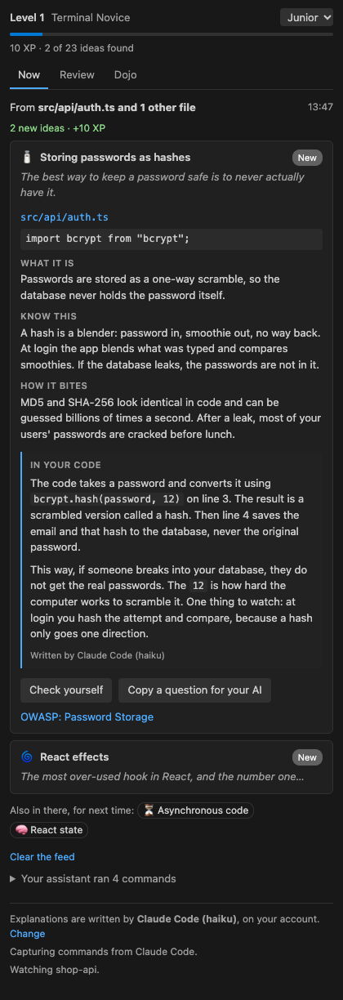

# Miyagi: learn while your AI codes

A side panel that watches what your AI assistant builds and teaches you the few ideas worth owning. It sits beside the assistant, not inside it: the assistant is never told the tutor exists, so it is not slowed down and its answers do not change.

Works in VS Code and its forks (Cursor, Antigravity, Windsurf), with any assistant that edits files in a git repository.

<p>
  
  
</p>

## Setup

There is nothing to configure. On first run Miyagi offers **Set up for me**, and one click:

- starts watching every git repository in the window (this is already on),
- picks the AI that will write explanations from the assistants it finds on your machine,
- turns on command capture for Claude Code and Cursor if they are installed, and
- opens the panel.

Run **Miyagi: Set Up Everything for Me** at any time to do the same. It is safe to repeat. Capture is the only step that edits another tool's settings, which is why it waits for that click.

## What you get

**Without any AI**

- **A card when it matters.** When new code relies on an idea such as password hashing, a React effect or a hard-coded secret, a card appears: what it is, what to know at your level, and how it goes wrong. At most two ideas per change; the rest are named and left for next time. Ideas that cost data or money when misunderstood carry a Risk tag.
- **A question that comes back.** Each idea leaves one multiple-choice question. Answer it now, then again after 10 minutes, 1, 3, 7, 16 and 35 days. A belt per idea shows how firmly you hold it.
- **Topics.** Pick Security, Backend and APIs, Data, Frontend or Tooling to see, be taught and review that shelf first.
- **A dojo you can browse.** Every idea is listed with its belt. Click one to read its lesson and see where it showed up in your code. Locked ideas can be read; their question unlocks when your assistant writes code that uses them.
- **What the assistant said.** Claude Code's own words from when it wrote a file, read from its session record.
- **Your week.** A report of what you met, what stuck and what is slipping.
- **The commands your assistant ran** (optional), with a short lesson for the common ones.

**With your own AI** (see the next section for who pays)

- **Explain in my code**, and **ask a follow-up** underneath.
- **Explain it yourself first.** Write what the lines do before reading any explanation, and have it judged.
- **Quiz me on my code.** A question about your own lines, not a textbook example.
- **Find the bug.** A copy of your code with one line changed. Your file is never touched.
- **Walk me through this change.** Steps in the order the data flows, each highlighted in the editor.
- **Check it for risks.** Up to three real risks in a change, with the line and the fix.
- **How this project works.** A map of the repository: what it is, how a request travels, where things live.
- **Find ideas with AI** (off by default). Lessons for ideas the built-in list does not know. These are marked as written by your AI.

## Who pays for the explanations

You do, through an assistant you already use. Miyagi has no account, no API key and no server. "Explain in my code" runs on one of these, on your existing login:

| Provider | How it is called | Tested |
| --- | --- | --- |
| Claude Code | The `claude` binary, headless, with the `haiku` model by default. Found on your PATH or inside the Claude Code editor extension. | Yes |
| Editor models | The chat models the editor offers to extensions (GitHub Copilot in VS Code). | Against a stub only |
| Codex | `codex exec`, read-only. Found on your PATH or inside the OpenAI editor extension. | Flags checked, not run live |
| Gemini CLI | `gemini -p` | Not tested |
| Ollama | A model on your machine, over its local HTTP API. Nothing leaves the machine. | Not tested: no Ollama here |
| Your own command | Anything that reads a prompt on stdin and prints an answer, for example `llm -m gpt-4o-mini`. | Yes |

In `auto` (the default) Miyagi uses the assistant it saw doing the work, else the first one it finds. Run **Miyagi: Choose Which AI Writes Explanations** to pick, or to turn AI off. Cards, questions and belts all work without any AI.

Nothing is sent to an AI unless you press a button, with two exceptions you have to turn on yourself: `miyagi.ai.explain: auto` (an explanation for every card) and `miyagi.ai.findIdeas` (ask your AI what is worth learning in a change, at most `miyagi.ai.findIdeasPerHour` times an hour). The footer of the panel shows how many AI calls Miyagi has made this week and roughly how many tokens.

Each request is a separate, short-lived process: no tools, no project context, no saved session. It cannot reach the conversation your assistant is working in.

## Where the panel sits

In VS Code 1.106 or newer the panel opens in the secondary side bar, on the right, by itself. Cursor, Antigravity and Windsurf keep that side bar for their own agent, so there Miyagi opens in the activity bar. Press the split icon on the panel's toolbar (**Miyagi: Open Beside the Editor**) to open it as a tab on the right instead.

## Keeping it out of the way

- **Pause** from the toolbar or the status bar: 30 minutes, an hour, three hours, or until tomorrow morning.
- **Quiet hours** (`miyagi.quietHours`, for example `22:00-07:00`): no cards, notifications or reminders.
- **Ignore patterns** (`miyagi.watch.ignore`) and **excluded repositories** (`miyagi.watch.excludeRepositories`).
- **Notifications** (`miyagi.notify`): off, a badge (default), or a toast.
- **Review reminder** (`miyagi.reviewReminder`): at most once a day when three or more questions are due, or off.

While paused or quiet, changes are still read, so nothing is taught late as though it had just happened.

## Your own ideas

Put a JSON file in `~/.miyagi/ideas/` and its ideas are taught like the built-in ones:

```json
{
  "name": "Our conventions",
  "concepts": [
    {
      "id": "feature-flag",
      "title": "Feature flags",
      "patterns": ["isEnabled\\(['\"]", "useFlag\\("],
      "hook": "Shipping the code is not the same as turning it on.",
      "what": "A switch that turns a feature on for some users without a deploy.",
      "lens": "The flag is checked at runtime, so the old path and the new path both have to keep working until the flag is removed.",
      "pitfall": "The flag is never cleaned up, and a year later nobody knows which of forty flags are safe to delete.",
      "questions": [
        {
          "question": "A flag has been on for everyone for six months. What should happen to it?",
          "answer": "Remove the flag and the old code path",
          "distractors": ["Leave it in case it is needed", "Turn it off to test the old path", "Rename it so it is clearer"],
          "explanation": "A flag that is always on is dead code with a switch attached."
        }
      ]
    }
  ]
}
```

**Miyagi: Show Diagnostics** lists each pack and anything in it that was rejected, with the reason.

## Capturing commands (optional)

Git shows what an assistant wrote, not what it ran. Setup adds a hook to Claude Code or Cursor that appends one line per tool call to `~/.miyagi/observations.jsonl`. The hook prints nothing and always exits 0, so the assistant cannot see it. It stores command lines (with secrets scrubbed), file paths and idea names; never file contents or command output.

It runs on Node.js if you have it and on the editor's own runtime if you do not (on Windows, Node.js is required). The hook is repaired automatically when Node, the editor or this extension is updated. **Miyagi: Turn On Command Capture** lets you choose the assistant and whether it applies to one project or all of them; **Miyagi: Turn Off Command Capture** removes it everywhere.

## What it reads and writes

- Reads: `git diff`, untracked files, and the file a card points at.
- Writes: `~/.miyagi/` (your progress, shared with the [Miyagi MCP server](https://www.npmjs.com/package/miyagi-mcp) if you use it). If you turn on capture, one hook entry in `~/.claude/settings.json` or `~/.cursor/hooks.json`, merged with what is there. Never your workspace, unless you choose capture for "this project only".
- Sends: nothing, except the lines included in a request you made to the AI provider you chose. Secrets in those lines are redacted first, and a line that holds a credential is withheld entirely.
- No telemetry. The cost meter and the weekly report are computed and kept on your machine.

## Limits

- Built-in ideas are detected with patterns over added lines, for 32 ideas today. It will miss things. "Find ideas with AI" and idea packs widen that.
- Without command capture it cannot tell your typing from your assistant's; with it, lessons say which assistant made the change.
- Everything an AI writes (explanations, risks, walkthroughs, found ideas) can be wrong. Each one names the model that wrote it.
- "What the assistant said" reads Claude Code's session files, whose format is not documented and may change.
- The first time a repository is seen, its existing uncommitted changes are treated as old. Run **Miyagi: Teach Me My Uncommitted Changes** to be taught those.

## Development

The extension bundles the engine from `../src`, so the panel and the MCP server share one implementation of concepts, grading, scheduling and persistence.

```bash
npm install
npm run typecheck
npm test            # engine, providers, diff tracking and the hook, under node:test
npm run test:host   # activates the extension inside a real editor and teaches from a file
npm run package     # builds miyagi-vscode-<version>.vsix
npm run release     # package, then publish to the VS Code Marketplace and Open VSX
```

`npm run release` reads `VSCE_PAT` and `OVSX_PAT` from the environment. Pushing a tag named `vscode-v<version>` does the same from CI.

`npm run test:host` takes an editor binary as an argument and defaults to VS Code, for example `npm run test:host -- "/Applications/Cursor.app/Contents/MacOS/Cursor"`. It uses a throwaway profile and `MIYAGI_HOME`.

To try a build: **Extensions: Install from VSIX...** and pick the `.vsix`.
